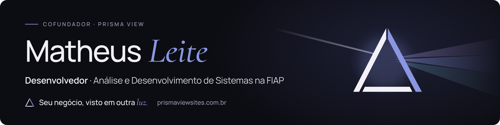

  

## Olá, eu sou o Matheus 👋

Estudo **Análise e Desenvolvimento de Sistemas na FIAP** e sou cofundador da **[Prisma View](https://prismaviewsites.com.br)**, um estúdio de landing pages para negócios locais. Gosto de levar um projeto do banco de dados até a tela: API em Java, front-end em React e o site publicado no ar.

- 🎓 FIAP · Análise e Desenvolvimento de Sistemas (turma 1TDSPO)
- 💼 Cofundador da Prisma View, com o sócio Dalton M
- 🌱 Estudando agora: Java com Spring Boot, React com TypeScript e banco Oracle
- 📫 Fale comigo pelo [LinkedIn](https://www.linkedin.com/in/matheusleite-dev/) ou pelo site da Prisma View

---

### 🔺 Prisma View · *Seu negócio, visto em outra luz.*

Criamos landing pages rápidas, bonitas e fáceis de achar no Google para restaurantes, clínicas, salões e lojas de bairro. Cuidamos de tudo: briefing, design, textos, domínio, publicação e manutenção.

  
  
  

---

### 🎓 Projetos da faculdade

| Projeto | O que é | Tecnologias |
|---|---|---|
| **[SoulUp](https://github.com/matheusruiz-07/Challenge-1TDSPO)** · Challenge FIAP 2026 | Plataforma que transforma ações sustentáveis em pontos, níveis e recompensas, com o avatar Soul acompanhando o usuário. Parceria com SoulUp e Prospera. [App no ar](https://challenge-1tdspo.vercel.app) · [vídeo](https://youtu.be/vWnaYeNxh5c) | React · TypeScript · Vite · Vercel |
| **[SoulUp API](https://github.com/matheusleite21/soulup-api)** | API REST do SoulUp: usuários, ações, missões e ranking, gravando no Oracle. [Swagger](https://soulup-api-k9nq.onrender.com/swagger-ui.html) | Java 21 · Spring Boot · JPA · Oracle · Docker · Render |
| **[ZelaSP](https://github.com/matheusleite21/zelasp-front)** · Global Solution 2026/2 · *em andamento* | Zeladoria colaborativa para São Paulo: o cidadão registra buraco, poste, entulho ou calçada e acompanha a resposta da prefeitura. [Prévia no ar](https://zelasp-front.vercel.app) | React · TypeScript · Tailwind · Vite |
| **[ZelaSP API](https://github.com/matheusleite21/zelasp-api)** | API REST do ZelaSP com JDBC puro e DAO, regras de negócio e erros padronizados em JSON. | Java 21 · Spring Boot · JDBC · Oracle · Docker |
| **[AeroCrop](https://github.com/matheusleite21/Front---GS)** · Global Solution 2026/1 | Central de alertas para produtores rurais: umidade do solo, temperatura e risco de geada a partir de dados de satélite. | HTML · CSS |

---

### 🛠️ Ferramentas

  
  
  
  
  
  
  
  
  
  
  
  

